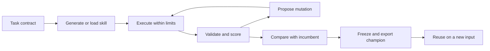
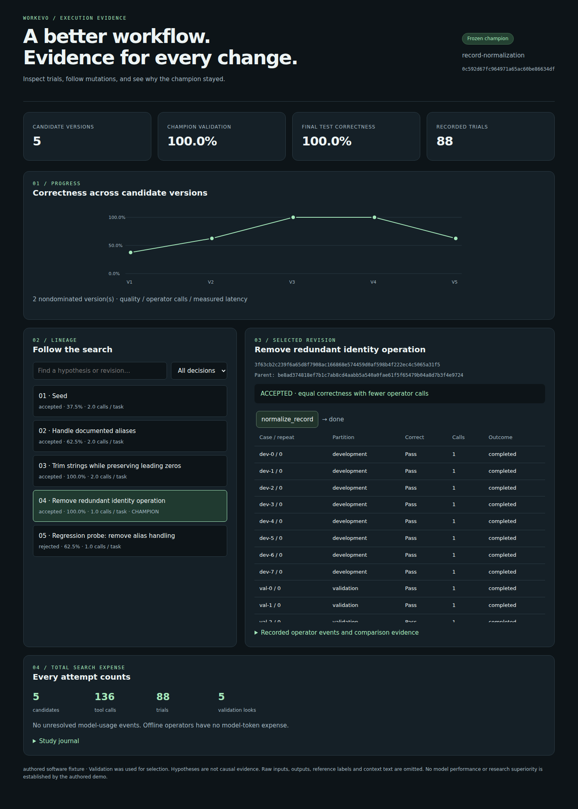

# workevo

[](https://github.com/Twilight-Techy/workevo/actions/workflows/check.yml)

**Improve the workflow. Keep the model fixed. Retain evidence for every change.**

workevo is a Python library and CLI for optimizing reusable agent skills through bounded execution, exact evaluation, and validation-gated selection. Instructions, operator parameters, tool order, branches, and retry bounds live in versioned artifacts outside the model.



The local `0.1.0` implementation includes the optimization loop, durable SQLite evidence, model callbacks, portable skill bundles, Pareto selection, a CLI, and an interactive inspector. Checks run offline by default. The current dataset is a small authored software fixture; a tiny live Haiku check is recorded separately from the unreviewed software fixtures.

## Run it

Requires Python 3.11+. From this project folder:

```bash
python3 -m pip install .
workevo demo --directory .workevo/demo
```

Or use the locked development environment:

```bash
uv sync --locked
uv run workevo demo --directory .workevo/demo
```

Open `.workevo/demo/inspector.html` in a browser. It is self-contained and makes no network requests. The directory also contains `report.json`, `skill.json`, `SKILL.md`, and the local execution database.

The scripted demo accepts alias handling and trimming, removes a redundant operation, then rejects a deliberately worse mutation. A separate [feedback example](examples/quickstart.py) proposes edits from development failures:

```bash
uv run python examples/quickstart.py
```

## Use the saved skill

Create `input.json` containing `{"identifier":" 0017 ","display_name":" Ada "}`, then run:

```bash
workevo execute .workevo/demo/skill.json \
  --input input.json --database .workevo/deployment.sqlite
```

The output includes `{"id":"0017","name":"Ada"}`. Deployment does not load reference answers or the evaluation dataset. Skill imports preserve provenance and do not automatically promote a champion.

## What is included

| Capability | Behavior |
| --- | --- |
| Bounded workflows | Registered async operators, sequences, boolean branches, visit/step bounds, retries, and artifact limits |
| Controlled optimization | Development feedback, paired validation, correctness floors, mutation limits, patience, and explicit stop reasons |
| Durable evidence | Immutable content identities, trial attempts, lineage, transactional champion updates, leases, and explicit crash recovery |
| Resource accounting | Candidate/trial/tool/model/retry/token/spend limits, reservations, reconciliation, and explicit unknown usage |
| Application-owned models | Target and proposer callbacks; no required SDK, endpoint, message format, or model vendor |
| Reusable artifacts | Verified JSON bundles, companion skill instructions, import/lookup, and independent execution |
| Multi-objective selection | Comparable nondominated alternatives, deterministic archive caps, and constrained routing |
| Context integration | Pinned application context and an optional [Navconr example](examples/navconr_context.py) |
| Inspection | Candidate search, decision filters, per-case outcomes, operator events, cost journal, and responsive local HTML |



The screenshot shows actual recorded authored-fixture trials. The displayed correctness is a software check, not a model-quality result.

## Integrate and extend

Your application registers trusted operators and supplies model callbacks that map its existing SDK responses into `CallResult`. The executor and optimizer models can differ; each identity and configuration stays fixed within a study. A supplied task scaffold can be replaced by a model-generated seed using `Optimizer.create(..., generate_seed=True)`.

See the [integration guide](docs/INTEGRATION.md), [API and CLI guide](docs/API.md), [contracts](docs/CONTRACTS.md), and [operations guide](docs/OPERATIONS.md). Registered Python callbacks are trusted application code; generated artifacts cannot introduce executable source or imports. This runner is not an OS sandbox for untrusted Python programs.

[SkillOpt](https://arxiv.org/abs/2605.23904), [GEPA](https://arxiv.org/abs/2507.19457), and [AFlow](https://arxiv.org/abs/2410.10762) already cover closely related optimization mechanisms. This project makes no novelty or superiority claim. The [related-work review](docs/research/RELATED_WORK.md) and [architecture decision](docs/decisions/001-core-and-reuse.md) explain the overlap and implementation choice.

## Verification and status

```bash
make check
make study
uv run python scripts/release.py
```

The [status document](docs/STATUS.md) separates verified software from pending empirical work. The offline comparison records 25 runs across five controls/policies and 1,416 trials; [results and limitations](reports/README.md) explain what those numbers mean. A [three-call Haiku check](reports/live-haiku.json) cost an estimated $0.0001235. One model-proposed mutation passed local exact checks; the separate two-record target check scored 1/2 baseline and 2/2 evolved. These are tiny integration results, not evidence of general superiority. Broader model comparisons, reviewed research data, and package-registry publication remain pending.

Licensed under [MIT](LICENSE). Local conversation history in `context/` is excluded from Git and distributions. No credentials or live model calls are needed for the commands above. The separate opt-in live benchmark is excluded from ordinary tests and CI.
