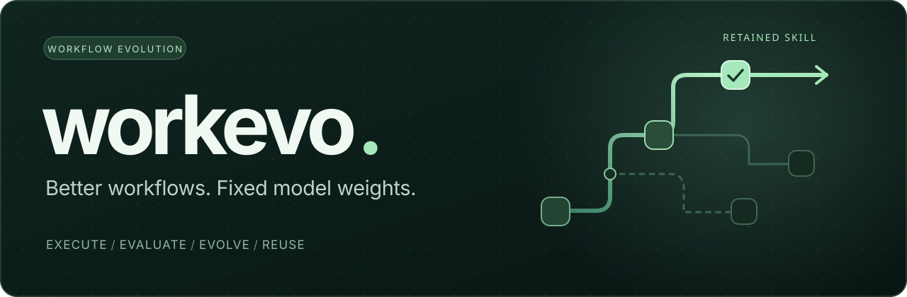
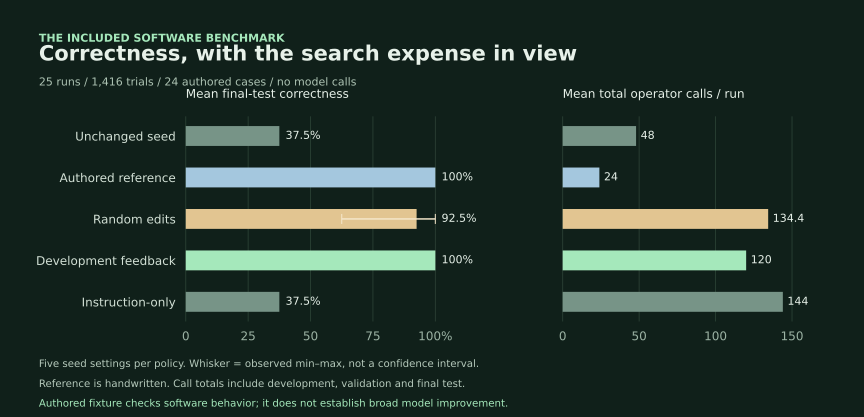

<p align="center">
  
</p>

<p align="center">
  <a href="https://github.com/Twilight-Techy/workevo/actions/workflows/check.yml"></a>
  <a href="README.technical.md"></a>
  <a href="LICENSE"></a>
  <a href="docs/STATUS.md"></a>
</p>

<p align="center">
  <strong>Turn execution feedback into a skill you can use again.</strong><br>
  Generate a workflow, run it, measure the result, and refine it.<br>
  Keep the best validated version while the underlying model stays fixed.
</p>

<p align="center">
  <a href="#try-it-in-a-minute">Quick start</a> ·
  <a href="#see-what-changed">Inspector</a> ·
  <a href="#benchmarks">Benchmarks</a> ·
  <a href="README.technical.md">Technical README</a> ·
  <a href="docs/INTEGRATION.md">Integrations</a>
</p>

---

## A successful run should leave something useful behind

Agent workflows often start from a prompt and finish with an answer. **workevo adds a learning loop around the workflow itself:** try a change, check its execution, compare it with the current best, and save a reusable skill when it earns its place.

That skill can carry instructions, tool order, branches, retry bounds, and context requirements. Your application keeps control of the model, tools, and evaluation criteria.

| Make progress you can inspect | Keep control of the experiment |
| --- | --- |
| **Keep the winner.** A later regression leaves the earlier champion in place. | **Set the limits.** Bound trials, calls, retries, time, and supported usage budgets. |
| **Reuse what worked.** Export a workflow and its evidence, then execute it on a new input. | **Bring your own model.** Connect application-owned callbacks without adopting a vendor SDK. |
| **Follow every change.** Inspect versions, decisions, per-case results, and recorded costs. | **Choose your tradeoff.** Keep comparable quality/cost/latency alternatives when you need them. |

## Try it in a minute

**Python 3.11+ · local example · no API key required**

```bash
git clone https://github.com/Twilight-Techy/workevo.git
cd workevo
python3 -m pip install .
workevo demo --directory .workevo/demo
```

Open **`.workevo/demo/inspector.html`** in your browser. The demo handles record aliases, fixes whitespace, removes a redundant step, and rejects a deliberately worse mutation. Everything runs locally.

You also get a saved skill (`skill.json` and `SKILL.md`), a result report, and an execution database. The [technical README](README.technical.md) shows how to use the saved skill and connect your own application.

<details>
<summary><strong>Prefer the locked development environment?</strong></summary>

```bash
uv sync --locked
uv run workevo demo --directory .workevo/demo
```

For a policy that chooses edits from actual development failures, run:

```bash
uv run python examples/quickstart.py
```

Both examples are offline. The separate live-model benchmark requires explicit invocation.

</details>

## See what changed

The local inspector shows the full journey: which version improved, which change was rejected, and which workflow was retained. Search candidates, filter decisions, and open the recorded case results and operator events.

[](reports/inspector.png)

<sub>Actual recorded local demo. The displayed scores come from authored software fixtures. The inspector is self-contained HTML and makes no network requests.</sub>

## Benchmarks

**25 offline runs · 1,416 trials · 5 policies and controls**

The included benchmark measures correctness and the work spent searching for a workflow on a **24-case record-normalization fixture**. It records all attempts and opens final-test cases only after freezing the champion.



| Policy / control | Mean final correctness | Mean total operator calls |
| --- | ---: | ---: |
| Unchanged seed | 37.5% | 48 |
| Manually authored reference | 100% | 24 |
| Random edits | 92.5% | 134.4 |
| Development-feedback policy | 100% | 120 |
| Instruction-only control | 37.5% | 144 |

These are **software benchmarks on authored data**, not evidence of broad model improvement. The reference is handwritten; instruction text does not affect the deterministic operators. Call totals include development, validation, and final-test execution. Random edits range from 62.5% to 100% across five seed settings.

> **A small live-model check is recorded separately.** Three Haiku generations used 775 input and 92 output tokens, for an estimated **$0.0001235** on November 17, 2026. One model-proposed workflow edit passed local exact checks. A separate two-record target check scored **1/2 baseline → 2/2 evolved**. This tiny integration result does not establish general performance gains.

**[Benchmark methods, costs, limits, and reproduction →](docs/BENCHMARKS.md)** · [Raw offline results](reports/software-study.json) · [Live receipt](reports/live-haiku.json)

## Build it into your workflow

workevo is a Python library and CLI. It works with registered async operators, application-owned target/proposer models, and pinned context. [Navconr](examples/navconr_context.py) is an optional context integration.

| I want to… | Start here |
| --- | --- |
| Understand the architecture and run a library example | [Technical README](README.technical.md) |
| Connect an existing model client or agent | [Integration guide](docs/INTEGRATION.md) |
| Use the CLI, import a skill, or inspect its contracts | [API guide](docs/API.md) · [Schemas](docs/schemas.json) |
| Reproduce results and understand their scope | [Benchmarks](docs/BENCHMARKS.md) |
| Check what is implemented and what is still open | [Project status](docs/STATUS.md) · [Research context](docs/research/RELATED_WORK.md) |

**Early release, MIT licensed.** The local software is implemented and tested. Broader reviewed research benchmarks and package-registry publication remain open. Registered Python operators are trusted application code; executing arbitrary generated programs requires a separate isolated runner.

<p align="center">
  <a href="LICENSE">MIT license</a> ·
  <a href="https://github.com/Twilight-Techy/workevo/issues">Issues & ideas</a> ·
  <a href="docs/README.md">All documentation</a>
</p>
