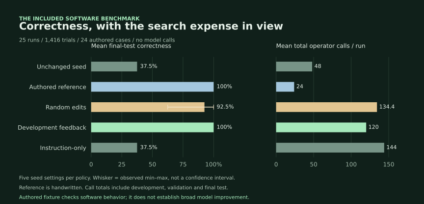

# Benchmarks

[Project introduction](../README.md) · [Technical README](../README.technical.md) · [Evaluation protocol](EVALUATION.md)

workevo has two kinds of recorded evidence: a reproducible offline software benchmark and a separate, explicitly authorized three-generation Haiku integration check. This page reports their scope, correctness, execution expense, and reproduction paths. An independently reviewed research benchmark remains open.

## Offline software benchmark



### Dataset and measurement

The benchmark uses 24 fictional record-normalization cases: eight development, eight validation, and eight final-test cases. Exact expected outputs are evaluator-owned. Cases cover aliases, whitespace, missing/invalid values, primary-field precedence, Unicode, extra fields, and identifiers with leading zeros.

Five policies/controls run under five seed settings, producing **25 runs and 1,416 trials**. Each run freezes its champion before opening final-test cases. A trial is one workflow revision executed on one case/repeat; it is not a unique task or a model request. Per-policy means summarize the five runs. Random edits use their seed; deterministic controls intentionally repeat the same policy.

| Policy / control | Final correctness, mean | Observed correctness range | Mean trials / run | Mean total operator calls / run |
| --- | ---: | ---: | ---: | ---: |
| Unchanged seed | 37.5% | 37.5–37.5% | 24 | 48 |
| Manually authored reference | 100% | 100–100% | 24 | 24 |
| Random edits | 92.5% | 62.5–100% | 91.2 | 134.4 |
| Development-feedback policy | 100% | 100–100% | 72 | 120 |
| Instruction-only control | 37.5% | 37.5–37.5% | 72 | 144 |

Operator-call totals include development, validation, final testing, and executed unsuccessful candidates. They measure local workflow execution expense; they are not model-token counts or deployment-only costs. Non-search controls naturally perform less work. No paid APIs are called by this benchmark.

### What the controls establish

| Policy / control | How it works | What the comparison checks |
| --- | --- | --- |
| Unchanged seed | Executes the initial schema-valid workflow | Starting correctness and execution expense |
| Authored reference | Starts from a handwritten correct one-node workflow | An engineering reference, not model-generated one-shot performance |
| Random edits | Chooses alias/trim flags and redundant-step inclusion randomly | The behavior of bounded unguided search in the same small operator space |
| Development feedback | Reads development failures, enables needed flags, then removes a redundant operation | Whether execution feedback and paired selection retain a working improvement |
| Instruction only | Edits instructions while keeping deterministic operators fixed | A negative control: those operators do not consume instruction text |

The same upper limits apply: six candidates, 512 trials, 4,096 operator calls, six validation looks, and a 120-second absolute deadline per run. Actual work is reported rather than assumed equal. The selector requires complete schema-valid evidence, the configured correctness floor, and zero paired per-case regressions. Strict quality gains win; exact quality ties can win with fewer operator calls.

### Limits of these results

Template identifiers and input values are disjoint across partitions, but the normalization semantics recur. These partitions are useful software coverage; they do not demonstrate robust domain transfer. The fixture was authored during development, and its labels have not received independent review. Five seed settings are not five independent samples from a real-world task distribution.

The plot's whisker is the observed seed-setting range, **not a confidence interval**. No superiority claim over SkillOpt, GEPA, AFlow, other models, or other task domains follows from this run. Instruction-only results say nothing about prompt optimization with an executor that actually consumes instructions. Search expense must be included before discussing deployment savings.

### Evidence and reproduction

- [Frozen software protocol](../reports/software-study-protocol.json)
- [Raw per-run/per-case results, lineage, decisions and usage](../reports/software-study.json)
- [Figure provenance and plotted values](assets/benchmark-results.json)
- [Runner implementation](../scripts/software_study.py)

From the repository root, write a fresh run to a local directory so the checked-in historical results stay intact:

```bash
uv sync --locked
uv run python scripts/software_study.py \
  --output .workevo/benchmark-review/software-study.json --repeats 5
```

The runner writes the protocol before executing search. It records dataset, implementation, script and environment identities. Exact quality/call totals are reproducible under the pinned configuration; durations, timestamps and generated study IDs vary.

To redraw the checked-in figure from the existing report, without running any workflows or calling a model:

```bash
uv run --with matplotlib==3.11.2 python scripts/render_benchmarks.py
```

The renderer recomputes the displayed aggregates from raw run records, rejects mismatches, and records the input report's SHA-256. To plot your fresh local run separately:

```bash
uv run --with matplotlib==3.11.2 python scripts/render_benchmarks.py \
  --source .workevo/benchmark-review/software-study.json \
  --output .workevo/benchmark-review/results.svg
```

## Small live Haiku integration check

Recorded **November 17, 2026**. One optimizer generation proposed a compact workflow edit. Registered local operators then executed the candidate against exact development/validation evidence, retained it, froze it, and opened the local final test. Separate baseline/evolved target calls each processed the same two additional held-out records in one batch.

| Part | Generation calls | Input tokens | Output tokens | Estimated cost, USD | Recorded outcome |
| --- | ---: | ---: | ---: | ---: | --- |
| Model-proposed workflow edit | 1 | 387 | 22 | $0.0000497 | Candidate accepted; local frozen-test fixture 100% |
| Baseline model-target batch | 1 | 161 | 36 | $0.0000341 | 1 of 2 records exact |
| Evolved-instruction model-target batch | 1 | 227 | 34 | $0.0000397 | 2 of 2 records exact |
| **Total** | **3** | **775** | **92** | **$0.0001235** | Zero automatic retries; no unresolved usage |

The model was `claude-haiku-5-5`, with low effort, thinking disabled, and a 256-token output cap per generation. Three token-count preflights preceded generation. The protocol used a $0.001 forecast stop rule; it is not a hard provider-billing guarantee. Cost is estimated from measured token counts and the recorded pricing snapshot, not an invoice. No cached tokens were reported.

The 100% local fixture result comes from deterministic operators selected by the model; it is not 100% model accuracy. The separate target check has only two records and one generation per condition. There are no statistical repeats, independently reviewed annotations, upstream comparisons, or transfer claims. The compact edit format is a domain-specific application adapter. Target results never feed back into workflow search.

[Pre-run live protocol](../reports/live-haiku-protocol.json) · [Measured live receipt and outputs](../reports/live-haiku.json) · [Opt-in benchmark script](../scripts/live_benchmark.py)

The live run belongs to [initial source revision 6697319](https://github.com/Twilight-Techy/workevo/tree/66973191606ec7738af82dc294469b0534e77e31). A later runtime-neutral typing correction changed the conservative implementation hash. Its original live protocol was preserved; no paid run was repeated to refresh that hash.

Rehearse the integration offline, using a fake transport:

```bash
uv run python scripts/live_benchmark.py --dry-run \
  --output .workevo/benchmark-review/haiku-rehearsal.json
```

Rehearsal usage/costs are explicitly simulated and must not be counted as API spending. `--live` makes paid requests and requires explicit authorization; the previously authorized three-call allowance has already been used. Ordinary tests and CI never invoke it.

## What remains to benchmark

The open research tasks cover independently reviewed data, genuinely distinct task families, predeclared practical gains and uncertainty analysis, compatible upstream optimizer baselines, repeated live-model comparisons, transfer, and total optimization/deployment cost. See [EVALUATION.md](EVALUATION.md), [related work](research/RELATED_WORK.md), and T015–T017 in [TASKS.md](TASKS.md).

These are missing evidence, not promised results. The current benchmark is intended to be easy to inspect and reproduce while those larger questions remain open.
